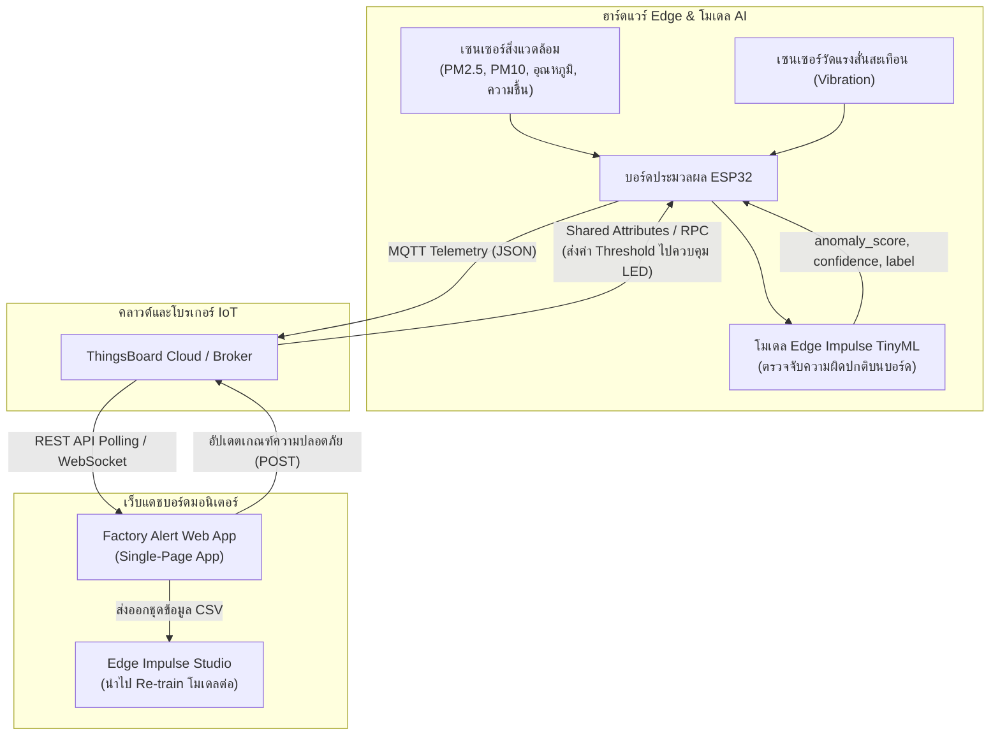

# Factory Alert | แพลตฟอร์ม Industrial Edge AI & IoT สำหรับโรงงานอัจฉริยะ

**Factory Alert** คือระบบแดชบอร์ดตรวจสอบสภาพแวดล้อมและตรวจจับความผิดปกติของเครื่องจักรในสายการผลิตแบบเรียลไทม์ (Real-time Industrial IoT & Edge AI Monitoring) โดยผสานการทำงานร่วมกันระหว่าง **บอร์ดไมโครคอนโทรลเลอร์ ESP32**, โมเดล **Edge Impulse TinyML** สำหรับตรวจจับความผิดปกติ (Anomaly Detection) บนอุปกรณ์ Edge Node และคลาวด์แพลตฟอร์ม **ThingsBoard (MQTT / REST API / WebSocket)**

---

## 🏗 ภาพรวมสถาปัตยกรรมระบบ (Architecture Overview)



---

## 🧠 ระบบ Machine Learning และ Edge AI (Edge Impulse)

ระบบนำเทคโนโลยี TinyML มาติดตั้งลงบนไมโครคอนโทรลเลอร์ ESP32 โดยตรงผ่านแพลตฟอร์ม **Edge Impulse**:

1. **การตรวจจับความผิดปกติบนตัวบอร์ด (On-Device Inference)**:
   - วิเคราะห์ข้อมูลแรงสั่นสะเทือนของเครื่องจักรและสภาพอากาศรอบข้างแบบเรียลไทม์
   - คำนวณคะแนนความผิดปกติ `anomaly_score` ($0.00$ ถึง $1.00$), ค่าความเชื่อมั่น `ai_confidence` ($0$ ถึง $100\%$) และความเร็วในการประมวลผล `inference_ms`
   - จำแนกสถานะการทำงานออกเป็น `normal`, `warning` หรือ `anomaly` / `danger`

2. **ระบบแจ้งเตือนระดับเตือนภัยอัตโนมัติ**:
   - **Warning (เตือนระวัง)**: เมื่อ Anomaly Score $\ge$ ค่าที่ตั้งไว้ (ค่ามาตรฐาน: `0.60`)
   - **Danger (อันตราย/ผิดปกติรุนแรง)**: เมื่อ Anomaly Score $\ge$ ค่าที่ตั้งไว้ (ค่ามาตรฐาน: `0.80`)
   - บันทึกประวัติและแสดงการแจ้งเตือนบนแดชบอร์ดทันที

3. **ไปป์ไลน์ส่งออกข้อมูลเพื่อเทรนโมเดลซ้ำ (Data Re-Training Pipeline)**:
   - สามารถกดปุ่ม **Export Edge Impulse CSV** (`export-ei-csv`) เพื่อดาวน์โหลดข้อมูลเซนเซอร์ในรูปแบบมาตรฐาน:
     ```csv
     pm25,pm10,temperature,humidity
     22.4,35.1,28.6,55.2
     ...
     ```
   - นำไฟล์ CSV ที่ได้ไปอัปโหลดเข้า **Edge Impulse Studio** เพื่อเทรนและปรับปรุงโมเดลให้แม่นยำยิ่งขึ้นได้ทันที

---

## ⚡ คุณสมบัติเด่นของระบบ (Key Features)

- **มอนิเตอร์เซนเซอร์เรียลไทม์**: แสดงผลค่าฝุ่นละออง PM2.5, PM10, อุณหภูมิ, ความชื้น, แรงสั่นสะเทือน และคะแนน Edge AI
- **กราฟวิเคราะห์แนวโน้ม (Reactive Trend Charts)**: กราฟิกแบบ SVG แสดงค่าสถิติ ต่ำสุด (Min), เฉลี่ย (Avg), สูงสุด (Max) และเส้นเกณฑ์ความปลอดภัย
- **ระบบแจ้งเตือนอัจฉริยะ (Alert Feed)**: กรองตามระดับความรุนแรง (Normal, Warning, Danger), คัดกรองตามวันที่ และส่งออกเป็นไฟล์ CSV
- **รายงานประวัติย้อนหลัง (Historical Reports)**: ดึงประวัติย้อนหลังจาก ThingsBoard Cloud ตามช่วงวันที่ที่กำหนด พร้อมพิมพ์เอกสารสรุปเป็น PDF
- **หน้าจอฝัง ThingsBoard Dashboard**: รองรับการฝังลิงก์ Public Dashboard จาก ThingsBoard เข้ามาในหน้าระบบได้ทันที
- **สร้างโค้ด ESP32 อัตโนมัติ (Firmware Generator)**: สเก็ตช์โค้ดภาษา C++ Arduino (`.ino`) ที่ใส่การตั้งค่า Wi-Fi และ ThingsBoard ให้พร้อมดาวน์โหลด
- **ระบบจัดการสิทธิ์ผู้ใช้งาน (RBAC)**: แยกบทบาทระหว่าง `Admin` (จัดการอุปกรณ์และตั้งค่าเกณฑ์) กับ `Operator` (ดูข้อมูลอย่างเดียว)
- **โหมดการแสดงผลสองแบบ (Dark / Light Theme)**: ปรับเปลี่ยนธีมมืดและสว่างได้ตามสภาพแสงในโรงงาน
- **ทำงานได้โดยไม่ต้องติดตั้งเซิร์ฟเวอร์ยุ่งยาก (Zero Dependencies)**: ใช้เทคโนโลยี Pure HTML5, CSS3 และ JavaScript (ES6+) รองรับการโฮสต์บน GitHub Pages ได้ทันที

---

## 📊 ข้อมูลจำเพาะฮาร์ดแวร์และรูปแบบ Telemetry Payload

### รูปแบบ JSON ส่งผ่าน MQTT ไปยัง ThingsBoard
ESP32 จะส่งข้อมูล Telemetry ไปยัง Topic: `v1/devices/me/telemetry`

```json
{
  "pm25": 24.5,
  "pm10": 42.0,
  "temperature": 29.8,
  "humidity": 58.4,
  "vibration": 0.04,
  "machine_id": "LINE-01-CNC",
  "anomaly_score": 0.12,
  "ai_confidence": 94,
  "ai_label": "Normal Running",
  "ai_status": "normal",
  "inference_ms": 18
}
```

### คำอธิบายฟิลด์ข้อมูลเซนเซอร์ (Telemetry Keys)
| ชื่อฟิลด์ (Key) | ชนิดข้อมูล | คำอธิบาย | หน่วยวัด |
| :--- | :--- | :--- | :--- |
| `pm25` | Float | ค่าฝุ่นละอองขนาดไม่เกิน 2.5 ไมครอน | $\mu\text{g/m}^3$ |
| `pm10` | Float | ค่าฝุ่นละอองขนาดไม่เกิน 10 ไมครอน | $\mu\text{g/m}^3$ |
| `temperature` | Float | อุณหภูมิสิ่งแวดล้อมหรือผิวเครื่องจักร | $^\circ\text{C}$ |
| `humidity` | Float | ความชื้นสัมพัทธ์ในอากาศ | $\%$ |
| `vibration` | Float | ค่าความสั่นสะเทือนของเครื่องจักร | $\text{g}$ หรือ $\text{mm/s}$ |
| `anomaly_score` | Float | คะแนนความผิดปกติจาก Edge AI | $0.00 - 1.00$ |
| `ai_confidence` | Integer | เปอร์เซ็นต์ความเชื่อมั่นของการจำแนก | $\%$ |
| `ai_label` | String | ป้ายชื่อสถานะ เช่น Normal, Fault | - |
| `ai_status` | String | ระดับสถานะ AI (`normal`, `warning`, `danger`) | - |

---

## 🔄 การซิงค์ค่าขีดจำกัดแบบสองทาง (Two-Way Threshold Synchronization)

เมื่อผู้ดูแลระบบปรับแต่งเกณฑ์แจ้งเตือนผ่านหน้าเว็บ **Settings** ระบบจะส่งข้อมูลไปอัปเดตยัง **ThingsBoard Shared Attributes** (`SHARED_SCOPE`) และเรียก **One-Way RPC** ไปยังตัวบอร์ด ESP32 อัตโนมัติ:

```json
{
  "pm25Warning": 35,
  "pm25Danger": 75,
  "pm10Warning": 50,
  "pm10Danger": 100,
  "tempWarning": 30,
  "tempDanger": 35,
  "humidityLow": 40,
  "humidityHigh": 70,
  "humidityDangerLow": 30,
  "humidityDangerHigh": 80,
  "anomalyWarning": 0.60,
  "anomalyDanger": 0.80
}
```

บอร์ด ESP32 ที่เชื่อมต่ออยู่จะได้รับเกณฑ์ชุดใหม่และนำไปปรับการติดสว่างของไฟเตือนสถานะ LED หรือเสียงไซเรนหน้างานได้ทันทีโดยไม่ต้องแฟลชโปรแกรมใหม่

---

## 🔐 สิทธิ์ผู้ใช้งานและบัญชีเริ่มต้น (User Roles & Default Accounts)

| บทบาท (Role) | บัญชีผู้ใช้ (Username) | รหัสผ่าน (Password) | สิทธิ์การใช้งาน |
| :--- | :--- | :--- | :--- |
| **Admin** | `admin` | `admin123` | **เข้าถึงเต็มรูปแบบ**: แก้ไขเกณฑ์ความปลอดภัย, เพิ่ม/ลบอุปกรณ์, ตั้งค่าเซิร์ฟเวอร์ ThingsBoard, จัดการรายชื่อผู้ใช้ |
| **Operator** | `operator` | `operator123` | **ดูข้อมูลอย่างเดียว**: ดูมอนิเตอร์สด, ตรวจสอบรายการแจ้งเตือน, ดึงประวัติ และดาวน์โหลดรายงาน |

*(มีปุ่มทางลัด Quick Access ที่หน้า Login เพื่อความสะดวกในการทดสอบระบบ)*

---

## 🚀 การติดตั้งและการเริ่มใช้งาน (Quick Start & Deployment)

### 1. การรันบนเครื่องคอมพิวเตอร์ (Local Development)
เนื่องจากโปรเจกต์นี้เขียนด้วย Pure HTML5, CSS3 และ JavaScript ไม่จำเป็นต้องสั่ง `npm install` หรือคอมไพล์โค้ด สามารถรันผ่านเว็บเซิร์ฟเวอร์ใดก็ได้:

```bash
# คัดลอกโปรเจกต์
git clone https://github.com/your-username/Application_Repo_Factory_Alert.git
cd Application_Repo_Factory_Alert

# เปิดเซิร์ฟเวอร์ด้วย Python (หรือใช้ Live Server บน VS Code)
python -m http.server 8080
```
เปิดเว็บบราวเซอร์ไปที่: `http://localhost:8080`

### 2. การนำขึ้นใช้งานบน GitHub Pages
1. ทำการ Push โค้ดทั้งหมดขึ้น GitHub Repository
2. ไปที่เมนู **Settings > Pages** ใน GitHub ของคุณ
3. ในหัวข้อ **Build and deployment** ให้เลือก **Source: Deploy from a branch**
4. เลือก Branch `main` และโฟลเดอร์ `/ (root)` จากนั้นกด **Save**
5. เว็บไซต์จะพร้อมเข้าใช้งานผ่านลิงก์ `https://<ชื่อผู้ใช้>.github.io/<ชื่อ-repo>/`

---

## 📁 โครงสร้างโฟลเดอร์โปรเจกต์ (Project Structure)

```
Application_Repo_Factory_Alert/
├── .github/
│   └── workflows/
│       └── main.yml        # เวิร์กโฟลว์ CI/CD สำหรับ GitHub Actions
├── index.html              # ไฟล์โครงสร้างหน้าเว็บหลัก (HTML5 & SVG Icons)
├── style.css               # สไตล์ชีตทั้งหมดของระบบ (รองรับ Responsive & Dark/Light Mode)
├── app.js                  # ลอจิกการทำงาน, เชื่อมต่อ ThingsBoard REST/WebSocket, คำนวณ Edge AI
├── README.md               # เอกสารแนะนำโปรเจกต์ฉบับภาษาไทย (Markdown มาตรฐาน)
```

---

## 💻 การสร้างและดาวน์โหลดเฟิร์มแวร์ ESP32 (.ino)

ระบบมีตัวช่วยสร้างโค้ดเฟิร์มแวร์ ESP32 Arduino C++ ในตัว:
1. เข้าไปที่เมนู **ESP32 & IoT Hub** (`#integrations`)
2. กรอก **ThingsBoard Host URL** (เช่น `https://thingsboard.cloud`) และ Token
3. เพิ่มชื่ออุปกรณ์จริงและรหัส **Device UUID** ที่ได้จาก ThingsBoard
4. กดปุ่ม **Download ESP32 Code (.ino)** หรือ **Copy code**
5. เปิดโค้ดด้วย **Arduino IDE** ติดตั้งไลบรารี `PubSubClient` และ `WiFi` ใส่รหัส Wi-Fi ของโรงงาน แล้วอัปโหลดลงบอร์ด ESP32 ได้ทันที

---
